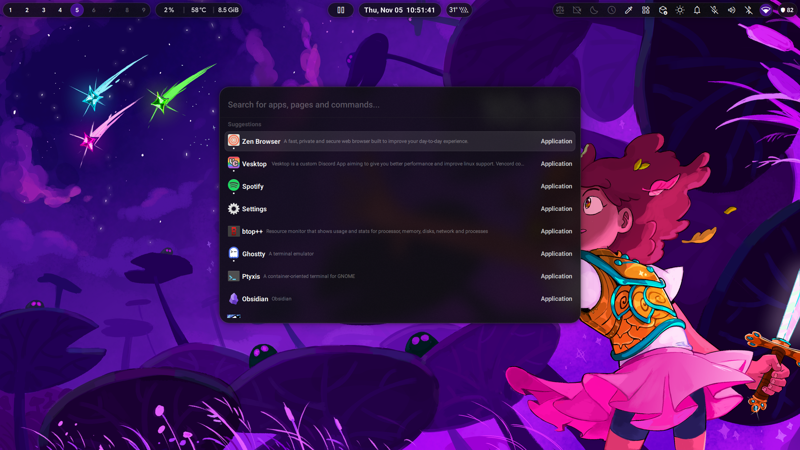
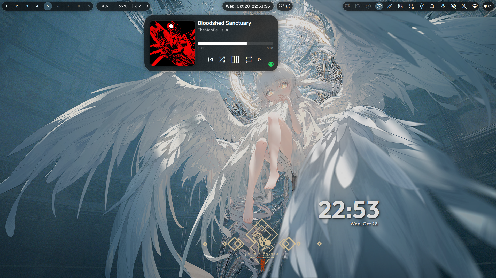
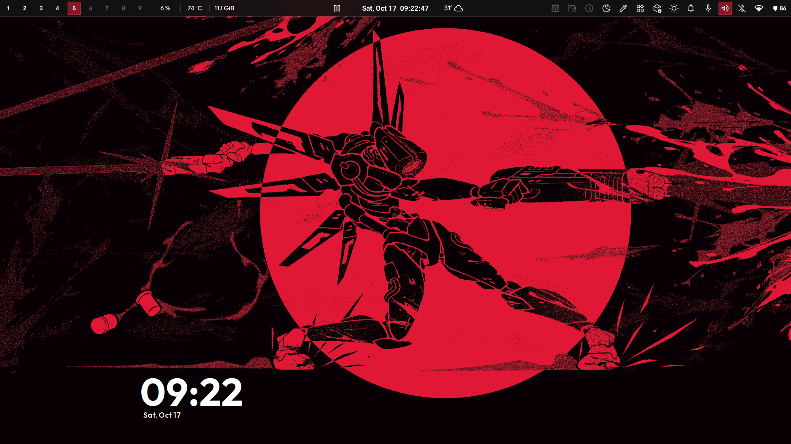
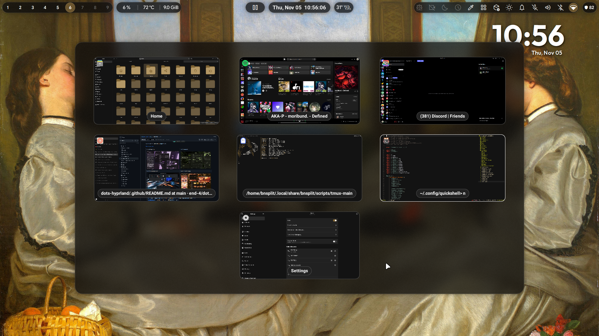

<div align="center">
    <h1>BnSplit's dotfiles</h1>
</div>

<https://github.com/user-attachments/assets/a6f72f9f-44ff-4d04-871c-307303bada15>

## Notable features

- Quickshell: bar, launcher, control center, notifications, OSD, lock screen, and greeter
- Launcher pages: apps, files, clipboard (via [bnclip](https://github.com/bnsplits/bnclip)), emoji, calculator, keybinds, monitors, processes, tasks, translate, wallpaper pickers, and web search
- Wallpaper-driven theming via [bnchroma](https://github.com/bnsplits/bnchroma) + [awww](https://codeberg.org/LGFae/awww/pulls/571/files)
- Lean GNOME integration: calendars events via Evolution Data Server, Control Center additional settings, Nautilus's Set as Background...

## Installation

Arch Linux only. `setup` expects `yay` and installs everything else.

```sh
git clone https://github.com/bnsplits/dotfiles.git
cd dotfiles
./setup
```

Existing files that would be overwritten are backed up first.

### Keybinds

- `Super + K` keybind list
- `Super + Enter` terminal

The keybind list only shows documented keyboard binds. Mouse binds, submaps, and undocumented binds are not listed.

## Software overview

| Software                              | Purpose                                                                            |
| ------------------------------------- | ---------------------------------------------------------------------------------- |
| [Hyprland](https://hyprland.org/)     | Wayland compositor                                                                 |
| [Quickshell](https://quickshell.org/) | QtQuick desktop shell: bar, launcher, OSD, notifications, lock screen, and greeter |
| Others                                | See [`setup`](setup) for the full package list                                     |

## Screenshots

<div align="center">
    
    
    
    
</div>
